# BÁO CÁO BÀI TẬP / ĐỒ ÁN

## THÔNG TIN SINH VIÊN
- **Họ và tên:** Lê Quang Hưng
- **Mã số sinh viên:** 24810320237
- **Lớp:** d19qtanm1
- **Tên môn học:** Lập trình .NET (C# / Windows Forms)
- **Tên bài tập:** Bài 5.1, 5.2, 5.3, 5.4

## CẤU TRÚC DỰ ÁN

Mỗi bài nằm trong thư mục riêng, có file solution riêng (ví dụ `5.1/5.1.slnx`), project Windows Forms (.NET 10):

| Thư mục / Solution | Nội dung |
|---|---|
| `5.1/5.1.slnx` | Form đăng ký tài khoản, bắt lỗi bằng `ErrorProvider` |
| `5.2/5.2.slnx` | Tính tiền dịch vụ và chiết khấu (`ListBox`, `ComboBox`) |
| `5.3/5.3.slnx` | Quản lý sản phẩm (`List<Product>`, `BindingSource`, `DataGridView`) |
| `5.4/5.4.slnx` | Quản lý nhân sự (`TreeView`, `ListView`, `ImageList`) |

---

## KẾT QUẢ THỰC HÀNH

## Bài 5.1: Form đăng ký tài khoản và bắt lỗi giao diện (ErrorProvider)

### 1. Ảnh màn hình Giao diện chính
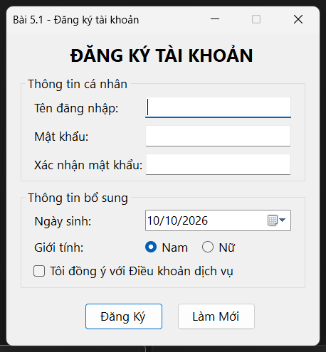

*Form đăng ký khi vừa mở.*

### 2. Ảnh màn hình Chức năng thực thi / Kết quả
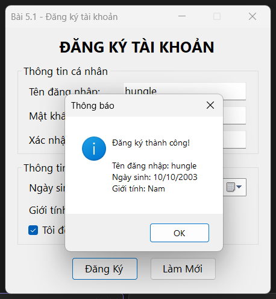

*Nhập đủ thông tin hợp lệ rồi nhấn Đăng Ký: hiện hộp thoại thông báo thành công.*

### 3. Ảnh màn hình Kiểm tra lỗi (Validation)
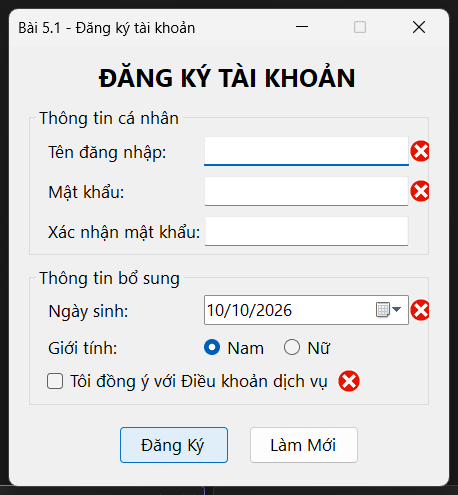

*Nhấn Đăng Ký khi để trống: ErrorProvider báo lỗi tại tên đăng nhập, mật khẩu, ngày sinh (chưa đủ 18 tuổi) và điều khoản.*

---

## Bài 5.2: Bảng tính tiền dịch vụ và chiết khấu đơn hàng

### 1. Ảnh màn hình Giao diện chính
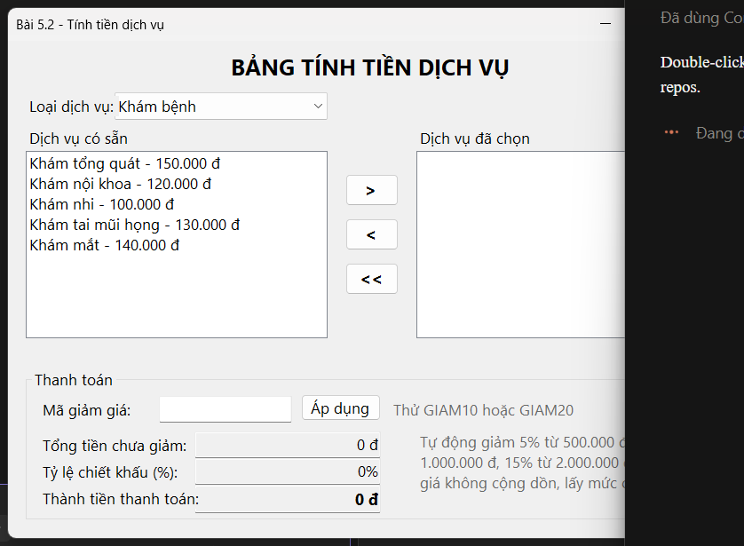

*Chọn loại dịch vụ ở ComboBox để nạp danh sách dịch vụ tương ứng.*

### 2. Ảnh màn hình Chức năng thực thi / Kết quả

*Chọn 5 dịch vụ (nhấp đúp hoặc nút >), áp mã GIAM10: tổng 680.000 đ, chiết khấu 10%, thành tiền 612.000 đ.*

### 3. Ảnh màn hình Kiểm tra lỗi (Validation)
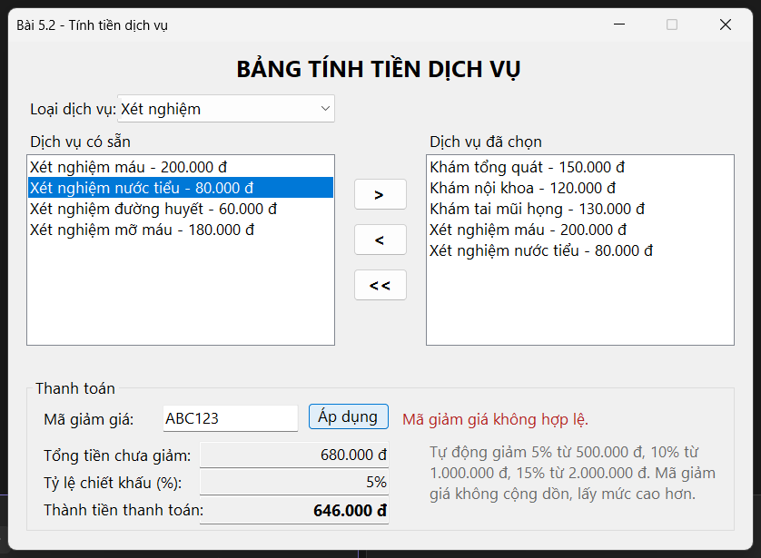

*Nhập mã giảm giá sai: hiện thông báo "Mã giảm giá không hợp lệ", chỉ còn chiết khấu tự động 5%.*

---

## Bài 5.3: Quản lý danh sách sản phẩm trong bộ nhớ

### 1. Ảnh màn hình Giao diện chính
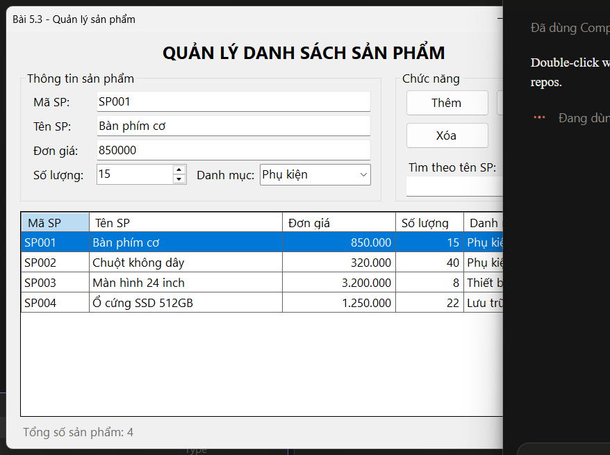

*Danh sách sản phẩm mẫu trên DataGridView.*

### 2. Ảnh màn hình Chức năng thực thi / Kết quả
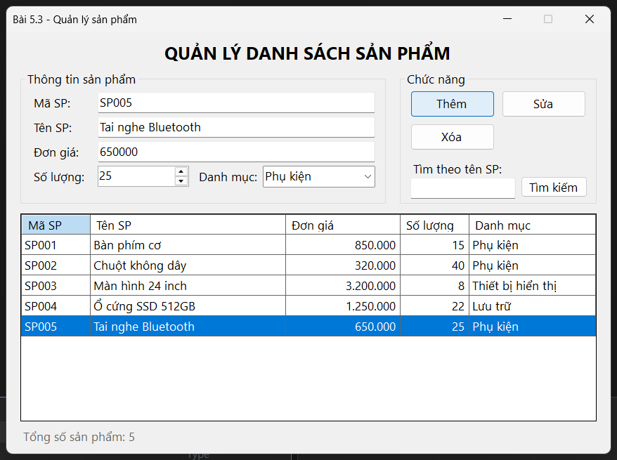

*Nhập thông tin và nhấn Thêm: sản phẩm SP005 xuất hiện trong bảng, dòng được chọn đẩy ngược lên các ô nhập.*

### 3. Ảnh màn hình Kiểm tra lỗi (Validation)
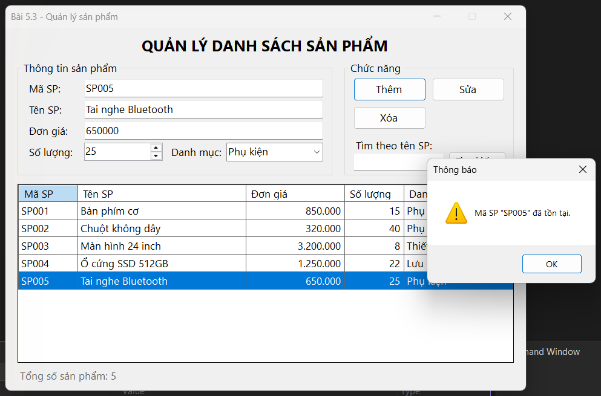

*Thêm mã SP đã tồn tại: hiện cảnh báo, không thêm trùng.*

---

## Bài 5.4: Trình quản lý nhân sự (TreeView và ListView)

### 1. Ảnh màn hình Giao diện chính
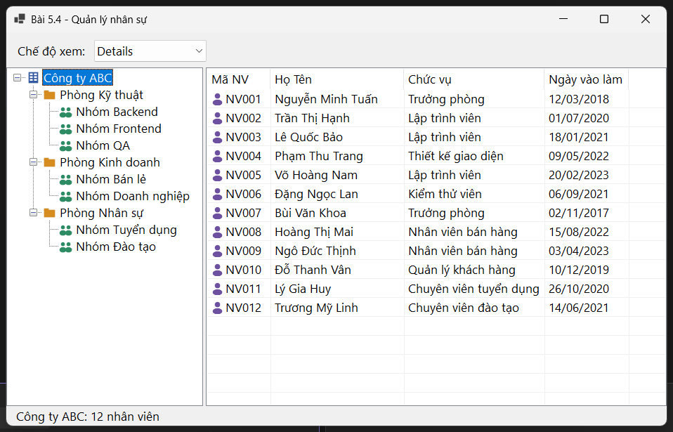

*Chọn nút gốc "Công ty ABC": ListView chế độ Details hiển thị cả 12 nhân viên.*

### 2. Ảnh màn hình Chức năng thực thi / Kết quả
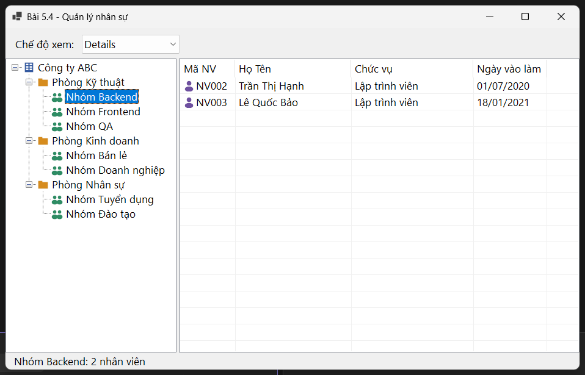

*Chọn "Nhóm Backend": ListView chỉ hiện 2 nhân viên thuộc nhóm.*

### 3. Ảnh màn hình Chế độ xem khác (LargeIcon)
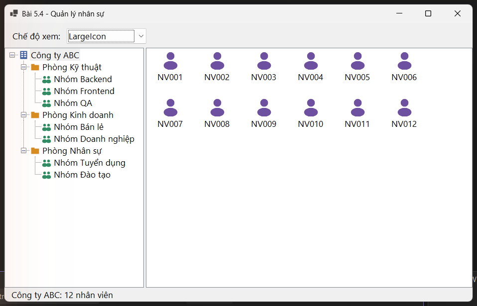

*Đổi chế độ xem của ListView sang LargeIcon.*
